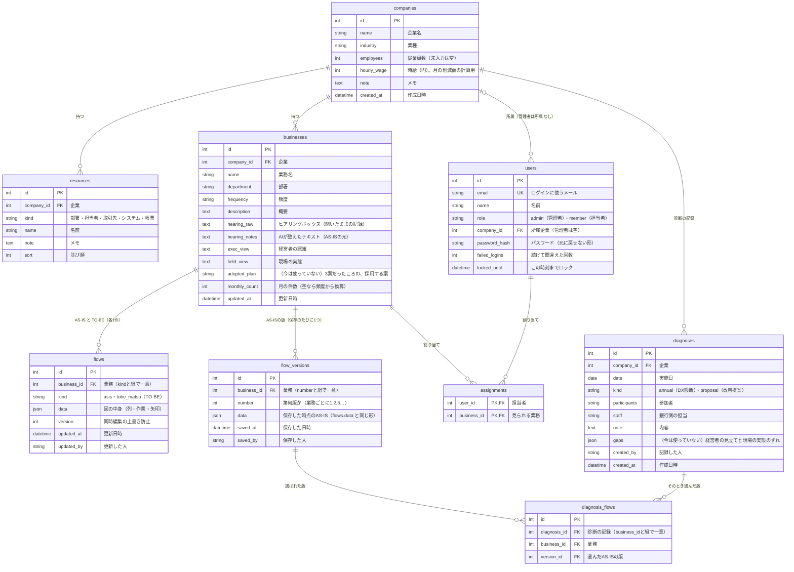

# ER図（データベースの構成）

`backend/app/db.py` のテーブル定義から作成しています。GitHub上ではこの図がそのまま描画されます（画像版は `er.png`）。



## テーブルの役割

| テーブル | 役割 |
|---|---|
| companies | 企業 |
| resources | **今は使っていません。** 以前は図の候補（部署・担当者・取引先・システム・帳票）を手で登録していました。今は、その企業の図に出てきた担当と道具を、そのまま候補にしています（テーブルとデータは残してあります） |
| users | ログインする人。管理者（admin）は企業に所属しない。担当者（member）はどこか1社に所属 |
| businesses | 業務。ヒアリングメモ・経営者の認識・現場の実態もここに入る |
| flows | 業務フロー本体（いまの状態）。1つの業務に AS-IS が1件と、TO-BE が1件。business_id と kind の組で一意 |
| diagnoses | 診断の記録（DX診断・改善提案）。企業ごとの履歴 |
| flow_versions | AS-ISの版。AS-ISを保存するたびに、その時点の中身が1行増える（あとから書き換えない）。過去のAS-ISをさかのぼるのに使う |
| diagnosis_flows | 診断の記録と、そのとき選んだAS-ISの版の結び付き（1つの記録で、1つの業務につき1つ）。年ごとの比較のもとになる |
| assignments | どの担当者がどの業務を見られる・編集できるか（多対多） |

- 削除のルール：企業を消すと、その企業のリソース・業務・担当者・フロー・割り当て・AS-ISの版・診断の記録もまとめて消えます（ON DELETE CASCADE）。診断の記録を消しても、AS-ISの版は消えません（版との結び付きだけが消えます）
- `flows.version` は保存のたびに1増え、古い画面からの上書きを防ぎます
- TO-BE は1つです。`kind = tobe_matsu` の行に入ります（松竹梅の3案だったころの「松」と同じ値。画面とAPIでは `tobe`）。`tobe_ume`・`tobe_take` と、さらに前の `tobe` の行は使いません（残っていても画面には出ません）
- `businesses.adopted_plan`（採用する案）は、TO-BEを1つにしたので今は使っていません（列は残してあります）
- `businesses.exec_view`（経営者の認識）と `field_view`（現場の実態）は、画面から入力欄と表示を外したので、今は使っていません（列とデータは残してあります）
- 月の削減額は保存していません。削減時間・企業の時給・業務の月の件数から、表示のたびに計算します（`frontend/lib/cost.ts`）
- 以前の単価表（`cost_items` テーブル）は使っていません。アプリはもう作りません（すでにあるDBには、テーブルが残っていても害はありません）
- 削減工数（月あたり・時間）は保存していません。AS-ISの第1版とくらべて、表示のたびに計算します：（第1版の作業時間 − その版の作業時間）× 月の件数（`backend/app/effort.py`）
- 削減時間は保存していません。AS-IS と TO-BE の作業時間の合計の差を、表示のたびに計算します

## flows.data の中身（JSON）

図の中身は、表を分けずに1つのJSONとして保存しています（形は `backend/app/schemas.py` の `Flow` / `Step`）。

```
{
  "summary": "…",                … TO-BEの要約（AS-ISでは使わない）
  "needs": ["RPAツール"],         … TO-BEの案で、導入・準備が必要なもの
  "removed_notes": {"S05": "…"},  … TO-BEの案で、なくした作業（排除）の理由（作業ID → 理由）
  "lanes": ["取引先", "営業部（受注）", "倉庫（出荷）"],     … 列（担当）の並び
  "steps": [
    {
      "id": "S02",                  … 作業のID
      "lane": "営業部（受注）",       … 担当（列）
      "row": 0,                     … 図の行（上から0,1,2…。null なら自動配置）
      "type": "作業",               … 作業・判断・システム処理・帳票・待ち
      "name": "FAXを見て手入力",
      "tool": "エクセル",            … 色付きの札（道具の名前）
      "minutes": 15,
      "pc": true,                   … 画面（PC作業）
      "manual_input": true,         … （今は使っていない。手入力の集計は作業名から自動で判断）
      "money": false,               … ¥ お金の流れ
      "issue": "ボトルネック",       … ボトルネックの印（null ならボトルネックではない）
      "issue_time": "手書きの文字を読み取りながら1件ずつ入力している",  … 時間がかかっている理由
      "issue_error": "手書き文字の読み間違い",   … ミスの原因
      "issue_detail": "",           … 旧データの説明（今は使わない）
      "third_party": false,         … 第三者の気づき
      "change": null,               … TO-BEの変更区分（統合・入替・簡素化・自動化・新規）
      "note": "",                   … 補足（TO-BEでは変更内容）
      "next": ["S03"],              … 矢印の行き先
      "next_media": ["メール"],      … 矢印ごとの受け渡し手段（next と同じ順）
      "condition_labels": []        … 矢印ごとの分岐ラベル（判断のとき）
    }
  ]
}
```

※ 図の候補（担当・道具）は、その企業の図に入っている `lane` と `tool` の名前から、表示のたびに集めています。
