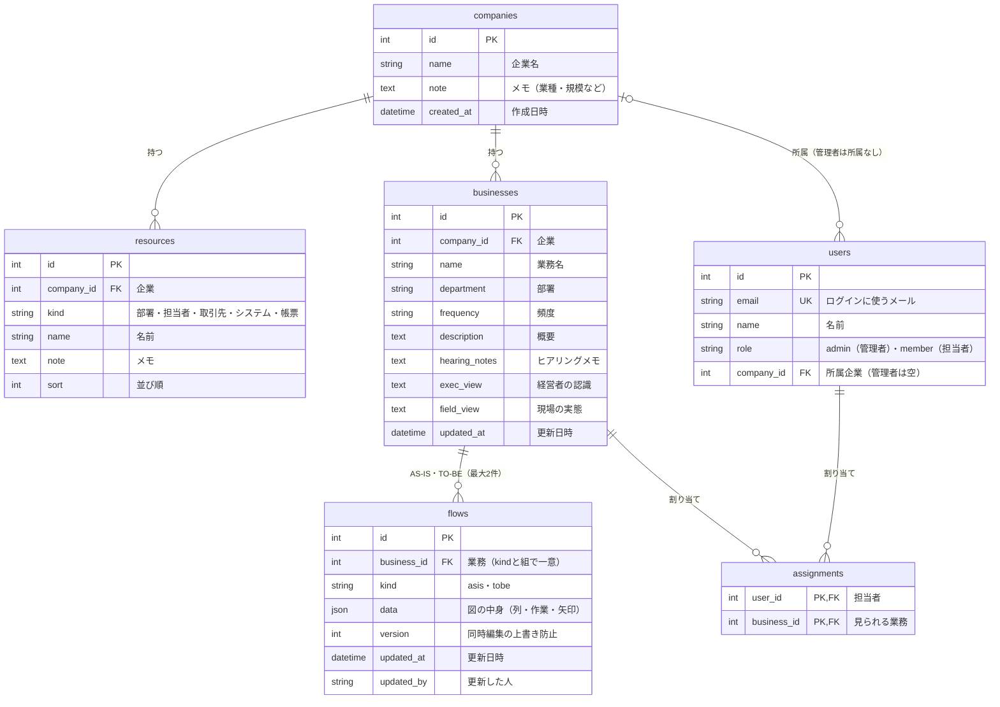

# ER図（データベースの構成）

`backend/app/db.py` のテーブル定義から作成しています。GitHub上ではこの図がそのまま描画されます（画像版は `er.png`）。



## テーブルの役割

| テーブル | 役割 |
|---|---|
| companies | 企業 |
| resources | 企業ごとのリソース（部署・担当者・取引先・システム・帳票）。図の列や道具の候補になる |
| users | ログインする人。管理者（admin）は企業に所属しない。担当者（member）はどこか1社に所属 |
| businesses | 業務。ヒアリングメモ・経営者の認識・現場の実態もここに入る |
| flows | 業務フロー本体。1つの業務に AS-IS と TO-BE が最大1件ずつ（business_id と kind の組で一意） |
| assignments | どの担当者がどの業務を見られる・編集できるか（多対多） |

- 削除のルール：企業を消すと、その企業のリソース・業務・担当者・フロー・割り当てもまとめて消えます（ON DELETE CASCADE）
- `flows.version` は保存のたびに1増え、古い画面からの上書きを防ぎます

## flows.data の中身（JSON）

図の中身は、表を分けずに1つのJSONとして保存しています（形は `backend/app/schemas.py` の `Flow` / `Step`）。

```
{
  "lanes": ["取引先", "営業部（受注）", "倉庫（出荷）"],     … 列（担当）の並び
  "steps": [
    {
      "id": "S02",                  … 作業のID
      "lane": "営業部（受注）",       … 担当（列）
      "row": 0,                     … 図の行（上から0,1,2…。null なら自動配置）
      "type": "作業",               … 作業・判断・システム処理・帳票・待ち
      "name": "FAXを見て手入力",
      "tool": "エクセル",            … 色付きの札（resources の名前を書き写したもの）
      "minutes": 15,
      "pc": true,                   … 画面（PC作業）
      "manual_input": true,         … （今は使っていない。手入力の集計は作業名から自動で判断）
      "money": false,               … ¥ お金の流れ
      "issue": "ボトルネック",       … ボトルネックの印（null ならボトルネックではない）
      "issue_time": "手書きの文字を読み取りながら1件ずつ入力している",  … 時間がかかっている理由
      "issue_error": "手書き文字の読み間違い",   … ミスの原因
      "issue_detail": "",           … 旧データの説明（今は使わない）
      "third_party": false,         … 第三者の気づき
      "change": null,               … TO-BEの変更区分（統合・入替・簡素化・自動化・新規）
      "note": "",                   … 補足（TO-BEでは変更内容）
      "next": ["S03"],              … 矢印の行き先
      "next_media": ["メール"],      … 矢印ごとの受け渡し手段（next と同じ順）
      "condition_labels": []        … 矢印ごとの分岐ラベル（判断のとき）
    }
  ]
}
```

※ `tool` や `lane` はリソースの「名前」を書き写しているため、あとでリソース名を変えても、作成済みの図の表記は変わりません。
